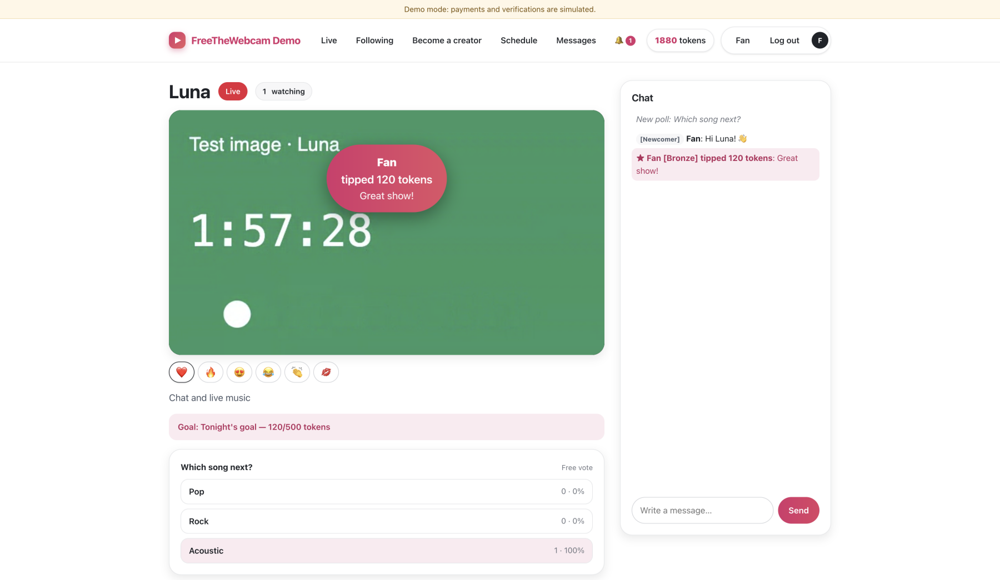
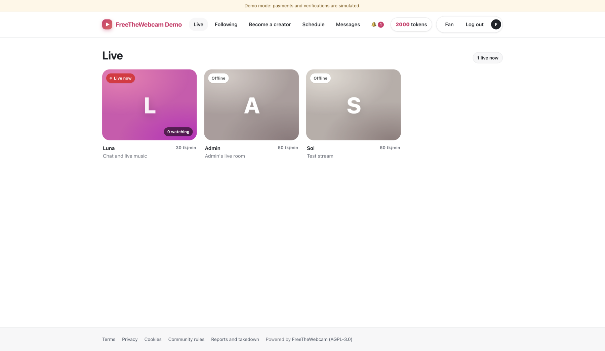
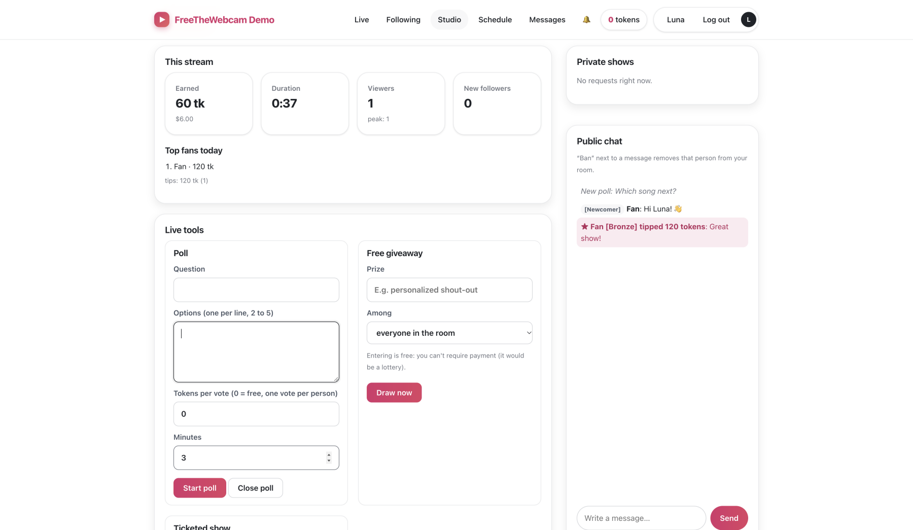
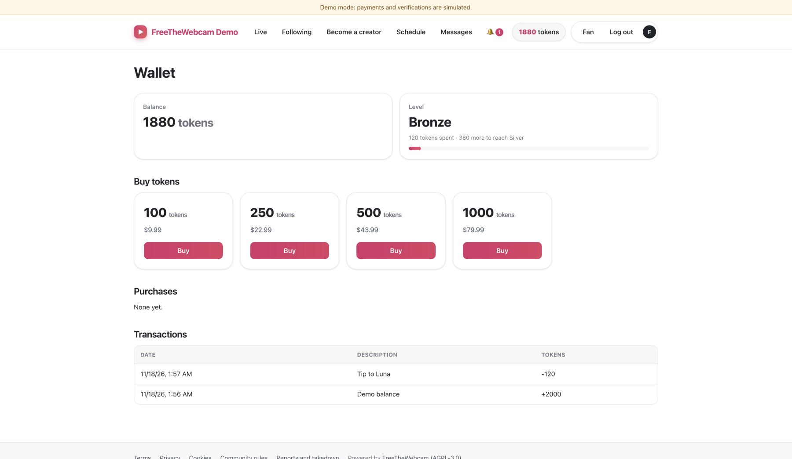
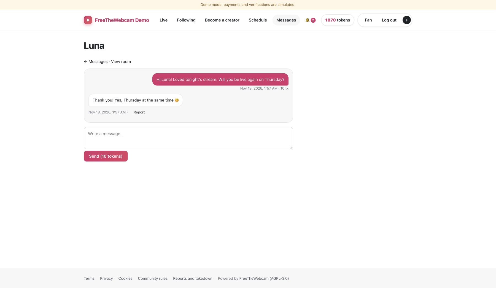

# FreeTheWebcam

**Live streaming infrastructure belongs to the people who stream.**

FreeTheWebcam is an open-source, white-label live webcam platform that anyone can run on their own server:
low-latency live video, chat, tips, private and ticketed shows, paid albums, direct messages, payouts and a
complete admin panel — with identity verification, consent, safety and compliance tooling built in.

License: [AGPL-3.0](LICENSE)



---

## The manifesto

**Every day, millions of people earn a living in front of a webcam.** They teach, perform, play, talk, sing,
entertain and build communities. And almost all of them do it on someone else's platform.

Those platforms decide who may stream and who may not. They set the prices, take a large share of every tip,
hold the money, own the audience and can change the rules — or close an account — overnight. The software that
powers live interaction between a creator and their audience has become a gate, and a handful of companies hold
the keys.

**We think that is backwards.** The technology itself is no longer scarce: real-time video, payments and
identity checks are standard building blocks. What has been missing is a complete, honest, open package that
puts them in the hands of the people who actually do the work.

So we are freeing the webcam:

1. **Own your platform.** Run it on your server, under your domain and your brand. Personal mode for a single
   creator; group mode for a studio or a cooperative.
2. **Own your audience.** Your followers, your messages, your schedule, your data. No algorithm between you and
   the people who choose to watch you.
3. **Own your income.** You choose your prices, your payment providers and your revenue split. Every token is
   recorded in a transparent double-entry ledger you can audit.
4. **No lock-in.** AGPL-3.0, standard technologies (Node.js, PostgreSQL, WebRTC), export everything. If someone
   improves the software and offers it as a service, those improvements come back to everyone.
5. **Safety is not optional.** Freedom only works with responsibility. Identity verification before going live,
   a verified record for every person on camera, consent captured explicitly, age assurance where the law asks
   for it, content scanning, reports and an audit trail are part of the core — not paid add-ons.
6. **Privacy by default.** Minimal data, personal records encrypted at rest, discreet notifications, no external
   trackers, fonts or CDNs.
7. **Built in the open.** Every decision, provider integration and safety rule is in this repository, readable
   and improvable by anyone.

Live streaming should be like the web itself: something you can publish on your own terms. This project is our
contribution to making that true.

---

> **Status: early release (v0.1).** Everything works end to end in **test mode** (payments and identity checks are
> simulated). Real integrations with CCBill, Vendo, Yoti, Veriff and Hive are implemented from their official
> documentation and covered by tests with mocked responses, but have not yet been exercised against real accounts.
> See the [roadmap](#roadmap).

## Features

| | |
|---|---|
| **Live video** | WebRTC via [LiveKit](https://livekit.io) (sub-second latency), broadcast from the browser or OBS (RTMP/WHIP), optional HLS "light mode" for large audiences, automatic recording of every show |
| **Viewers** | Live chat with levels, quick reactions, animated tips, tip menu, goals, polls, free giveaways, follow, notifications (in-app and browser push, discreet by default), schedule of upcoming shows, direct messages |
| **Monetization** | Token packages, tips, menu requests, per-minute private shows (with optional cam2cam), ticketed shows, paid direct messages, paid photo/video albums, creator payouts — all on a double-entry ledger |
| **Creators** | Studio with live stats (session earnings, top fans, peak viewers), room settings, goal and menu, polls, giveaways, ticketed shows, chat moderators, slow mode, banned words, schedule, albums, earnings and payouts |
| **Admins** | Users, creators, live rooms, verifications, providers, regional rules, economy and levels, ledger, payouts, private shows, reports, moderation queue, album review, performer records, legal pages, audit log, branding |
| **Trust and safety** | Identity verification before broadcasting, verified records for every performer on camera, optional age assurance per region, live-frame scanning with automatic cut-off, report handling, encrypted personal data, audit trail |
| **White label** | Brand name and colour from the admin panel, general-audience or 18+ mode, editable legal templates, no external fonts or trackers |
| **Operations** | One-command installer, Docker Compose, automatic HTTPS (Caddy), `./ftw` for updates, backups, restore and optional services, horizontal scaling with Redis |

<table>
<tr><td></td><td></td></tr>
<tr><td></td><td></td></tr>
</table>

## Quick start (local demo)

Requirements: Node.js 22.18+ and the LiveKit server binary (`brew install livekit` on macOS, or see
[LiveKit's documentation](https://docs.livekit.io/)).

```bash
npm install
npm run demo
```

Open <http://localhost:3000>. The demo creates sample accounts (password `demo1234`):

| Email | Role |
|---|---|
| `admin@demo.local` | Admin (can also broadcast) |
| `luna@demo.local` | Approved creator with menu, goal and a scheduled show |
| `sol@demo.local` | Approved creator, moderator in Luna's room |
| `nova@demo.local` | Creator waiting for approval |
| `fan@demo.local` | Viewer with 2,000 test tokens |
| `newbie@demo.local` | Viewer without tokens |

Use two browser sessions (e.g. a normal and a private window, or `localhost` and `127.0.0.1`).
Creators without a camera can use **“Start with test pattern”**.

## Deploy on a server

Requirements: a Linux server with Docker, a domain pointing to it, and ports 80, 443, 7881/tcp and
50000–60000/udp open.

```bash
git clone https://github.com/fransierra97/freethewebcam.git && cd freethewebcam
./install.sh
```

The installer asks for the domain and an email for Let's Encrypt, generates all secrets, starts the stack
(app, PostgreSQL, Redis, LiveKit, Caddy) and prints a one-time setup link. The setup wizard asks whether the site is
**general audience** or **adults only (18+)**; the second enables viewer age assurance, 18+ notices and performer
record-keeping (18 U.S.C. 2257). Then, in the admin panel:

1. **Providers** – add your payment, identity and moderation credentials (stored encrypted), test them and switch to live mode.
2. **Regions** – review age-assurance rules and providers per market and country.
3. **Economy and levels** – token packages, revenue share, payout value, viewer levels.
4. **Compliance** – operator and custodian-of-records details.
5. **Legal pages** – review the templates with a lawyer in your jurisdiction.

### Operations

```bash
./ftw status                      # services
./ftw update                      # backup + update + restart
./ftw backup [--media]            # database and encrypted data (and recordings)
./ftw restore backups/db-….sql.gz backups/data-….tgz
./ftw enable obs                  # OBS ingest (LiveKit Ingress)
./ftw enable recording            # recordings and HLS (LiveKit Egress)
./ftw enable turn                 # TURN over TLS for restrictive networks
./ftw cron                        # recommended scheduled jobs
```

Keep a copy of `.env` somewhere safe: without `APP_SECRET` encrypted records and credentials cannot be read.

## Providers

| Purpose | Provider | Status |
|---|---|---|
| Card payments | CCBill (FlexForms, dynamic pricing) | Implemented, needs real-account testing |
| Local payments (Pix, OXXO) | Vendo | Implemented, needs real-account testing |
| Creator ID + liveness | Yoti (official SDK), Veriff | Implemented, needs real-account testing |
| Viewer age assurance | Yoti Age Verification | Implemented, needs real-account testing |
| Viewer age assurance | EU age-verification app, Unico | Test mode only (public specs not sufficient yet) |
| Content scanning | Hive (hash matching + classifier), or your own scanner via a signed webhook | Implemented |

Every provider ships **pre-configured in test mode** with a built-in simulator, so the whole platform can be
evaluated before signing any contract. If a provider is live, a forgotten test-mode provider is never used.

## Architecture

```
Browser ──HTTPS──▶ Caddy ──▶ App (Node.js 22 + TypeScript, Fastify)
   │                 └─/rtc─▶ LiveKit SFU ──▶ Ingress (OBS) · Egress (recordings, HLS)
   └──WebRTC (UDP/TCP)────────▲
App ──▶ PostgreSQL (data, double-entry ledger) · Redis (multi-instance chat and presence)
```

Details in [docs/ARCHITECTURE.md](docs/ARCHITECTURE.md).

## Development

```bash
npm run dev         # server with reload (needs LiveKit at ws://localhost:7880)
npm test            # test suite with embedded PostgreSQL (PGlite)
npm run test:pg     # same suite against a PostgreSQL wire-protocol server
npm run typecheck
```

TypeScript runs directly on Node (no build step). Without `DATABASE_URL`, an embedded PostgreSQL (PGlite)
is used. The UI is server-rendered HTML with small ES modules; styles live in `public/theme.css`.

## Roadmap

- Test the real provider integrations against sandbox accounts.
- EU age-verification app and Unico once their public specifications allow it.
- Production validation of OBS ingest, recordings, HLS and TURN.
- Internationalization (UI translations beyond English).
- Installable PWA.

## Contributing and security

Contributions are welcome — see [CONTRIBUTING.md](CONTRIBUTING.md). Please report vulnerabilities privately as
described in [SECURITY.md](SECURITY.md). Everyone taking part is expected to follow the
[code of conduct](CODE_OF_CONDUCT.md).

## Legal

FreeTheWebcam is software. Whoever operates an installation is responsible for complying with the laws that
apply to them (consent, age assurance, record-keeping, data protection, taxes, payments). The legal templates and
compliance notes in this repository are not legal advice.
