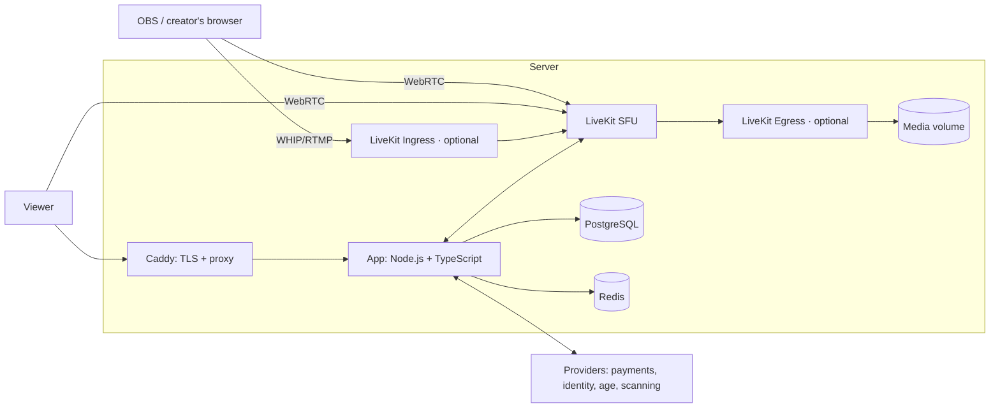

# FreeTheWebcam architecture

Open-source, white-label live webcam platform. Two modes from the same code base: **personal** (one creator,
their own domain) and **group** (a studio or platform with many creators).

## Principles

1. **One-command install**: `./install.sh` + Docker Compose; automatic HTTPS.
2. **Creators own** their domain, audience, income and data.
3. **Safety built in**: nobody goes live without identity verification, and every person on camera has a verified record.
4. **Replaceable parts**: payments, verification and content scanning live behind adapters, all pre-configured in test mode.
5. **Privacy by default**: minimal data, encrypted personal records, discreet notifications.

## Components

| Layer | Choice | Why |
|---|---|---|
| Live video | LiveKit (Apache-2.0) | WebRTC SFU with sub-second latency, private rooms, ingest and recording as separate services |
| Application | Node.js 22 + TypeScript without a build step, Fastify | One language on server and client; instant start-up |
| UI | Server-rendered HTML + small ES modules | Fast, accessible and easy to restyle (`public/theme.css`) |
| Data | PostgreSQL (embedded PGlite for the demo and tests) | Transactions and a double-entry ledger |
| Real time | WebSocket + in-memory or Redis bus | Chat, presence and notifications with one or many instances |
| Proxy | Caddy | Automatic certificates; LiveKit signalling on the same domain (`/rtc`) |

## Domain

- **Accounts and roles**: viewer, creator, room moderator, admin.
- **Rooms**: public live, per-minute 1:1 private show (with optional cam2cam), ticketed show.
- **Interaction**: chat with levels, reactions, animated tips, tip menu, goals, polls, free giveaways.
- **Economy**: tokens on a double-entry ledger; creator/platform revenue split; payouts; refunds and chargebacks.
- **Content**: encrypted photo and video albums (AES-256-CTR with ranged reads), public cover, review before publishing.
- **Social**: follow, in-app and browser push notifications, schedule, direct messages.

## Trust, safety and compliance

- **Creator identity**: document + liveness check with a provider before going live.
- **Performer records**: legal name, date of birth, aliases and an ID copy, encrypted; every stream and album records who
  appears; exportable index for the custodian of records (18 U.S.C. 2257 where it applies).
- **Content type**: general audience or adults only (18+). Adults-only sites add viewer age assurance per region, with
  providers in order of preference and per-country rules; lowering a rule requires confirmation and is audited.
- **Moderation**: encrypted control frames during live shows and scanning of uploaded photos (Hive or your own scanner);
  on a match the stream is cut, the account suspended and the evidence preserved.
- **Payments and webhooks**: verified signatures (HMAC) or official IP lists; amounts checked; idempotent processing.
- **Data**: provider credentials and personal data encrypted with the master key (`APP_SECRET`).

## Deployment

- `./install.sh` generates `.env` and the configuration, then starts the app, PostgreSQL, Redis, LiveKit and Caddy.
- `./ftw enable obs|recording|turn` turns on Ingress, Egress and TURN over TLS (using Caddy's certificate).
- `./ftw backup` and `./ftw restore` for backups; `./ftw update` updates after taking a backup.
- Multiple app instances: Redis for the real-time bus and PostgreSQL leases for periodic jobs.

## Open items

- Test the real integrations against provider accounts.
- EU age-verification app and Unico once their public documentation allows it.
- Validate Ingress, Egress, HLS and TURN in production.
- UI translations.

## License

**AGPL-3.0**: anyone offering a modified version as a service must publish their changes.
